# bifrost
a brawlhalla modded client

Bifrost is a layer on top of Brawlhalla: its own menus and options, P2P matches, its own server for accounts, rooms,
queues, friends, clans and tournaments, training and replay tools, content mods and more. Players install it with
[the Bifrost app](https://github.com/Saorax/bifrost-app), which converts their own copy of the game on their PC.
This repo has no game code, art or files.

## Features

**Engine and display** (Options, GRAPHICS)
- The game runs on a new engine (HashLink + Heaps) instead of Adobe AIR.
- DirectX 11, DirectX 12 or Vulkan renderer.
- Frame pacing (F11), frame rate (monitor, unlimited or a number), VSYNC.
- Display mode: the game's setting, windowed, borderless or exclusive fullscreen.
- Stats overlay (F12): FPS, frame time, ping and P2P connection details.
- Screenshots (Ctrl+F12), hide the HUD (Shift+F12), free camera (Ctrl+Shift+F12).

**Online** (on a Bifrost server)
- Bifrost plays on `bifrost.saorax.com` by default.
- Player-run servers ([bifrost-server](https://github.com/Saorax/bifrost-server)), added in Options, SERVERS. Bifrost
  never contacts the official online services.
- Discord sign-in.
- P2P matches with rollback netcode. With players who aren't your friends, a relay hides your IP.
- Casual and ranked queues, custom rooms, rejoining after a disconnect and spectating.
- Online Training in a custom room.
- Content mods travel with players: missing mods download, and a match won't start when mods differ.
- Everything is unlocked and nothing is sold.

**Social**
- Friends, profiles, clans and leaderboards.
- Tournaments: double elimination, pools, crew battles, map picks and bans.
- Discord Rich Presence.

**Ranked**
- Match preview with rating tags, and the rating change after the match.
- Different ELO progression than Official

**Training**
- Bifrost's Training settings page.
- Saved states: F1 saves, F2 loads.
- Dummy recording: Shift+F1 records, Shift+F2 replays.
- Frame data (Ctrl+F1), hitbox trail (Ctrl+F3).
- Bot DI after hits (Ctrl+F4) and bot recovery (Shift+F4).
- Training in game modes, and an Ascended bot level above Chosen.
- Move editor: change a legend's moves and save them as a mod.

**Replays and match stats**
- A Replays page in place of the game's list (switch back in Options):
  - Recent, Favorites and Older folders;
  - each replay listed by its file name with its stage, game mode and legends;
  - quick filters you can combine (wins, losses, 1v1, 2v2), and filters by legend, map, opponent, mode and tag;
  - each match's players and a KO timeline: watch from any KO;
  - notes and tags;
  - share codes.
- Match stats kept for every match you play, and for any replay with GET STATS (no need to watch it through).
- WATCH REPLAY on the scoreboard opens the match's replay once it's saved.
- KEEP RECENT moves older replays aside.
- Video export (Ctrl+F9 while a replay plays).
- MATCH STATS on the scoreboard (Tab) and in replays.

**Controls**
- Input display in matches and Training, with keyboard or controller drawings.
- Several keyboards, per-controller button mapping and control profiles.
- Legend Setups in character select, with share codes.

**Content mods**
- The Mods screen: turn mods on and off and get community mods from the server.
- Mods can add skins, items, legends, maps, game modes, languages, music and sounds.
- Community `.bmod` files dropped into the mods folder (or picked with IMPORT .BMOD) are converted into mods by the
  game: skins, weapon skins, avatars and map art.
- Colour editor, a web map editor and example mods.
- The [Bifrost Mod Kit](https://saorax.com/bifrost/mods) shows everything a mod can add or change, with examples.
  The [map editor](https://saorax.com/bifrost/map-editor) and a [move editor](https://saorax.com/bifrost/move-editor)
  are on the same site.

**Menus**
- Bifrost's Options, with a description for every setting and a search.
- Import the official game's settings, key bindings and picks.
- Save file editor and achievements.

## Screenshots

<table>
<tr><td width="50%">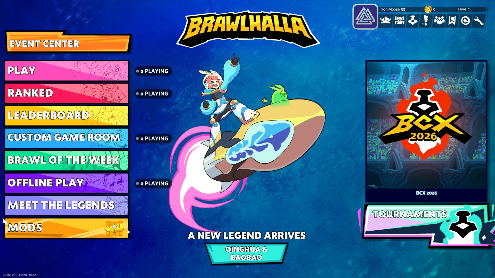<br>Main menu with player counts, Mods and Tournaments</td><td width="50%">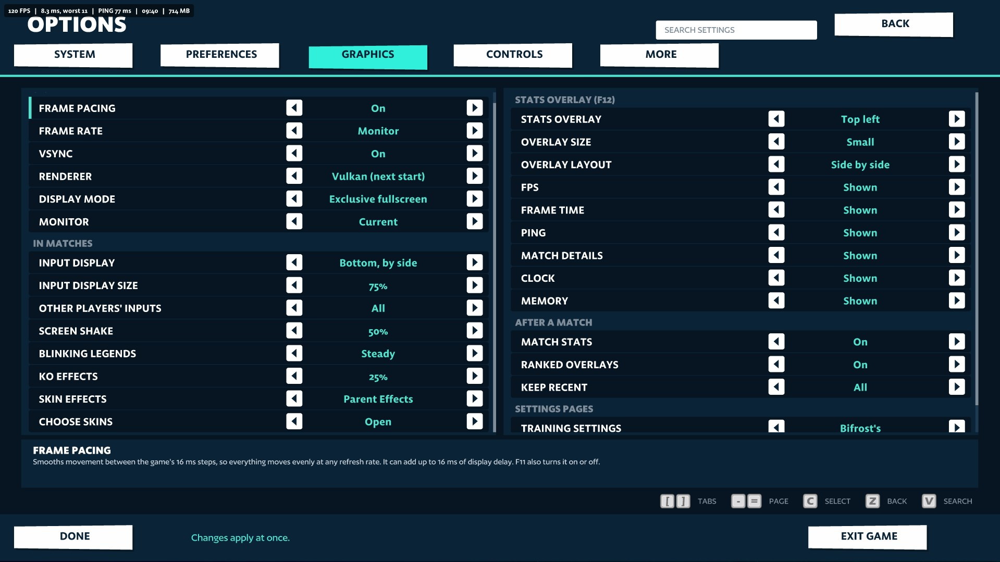<br>Options, GRAPHICS</td></tr>
<tr><td width="50%">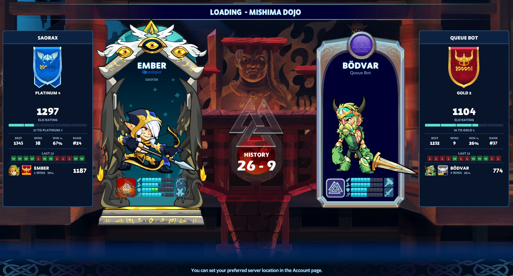<br>Ranked loading screen: ratings, recent results and head-to-head</td><td width="50%">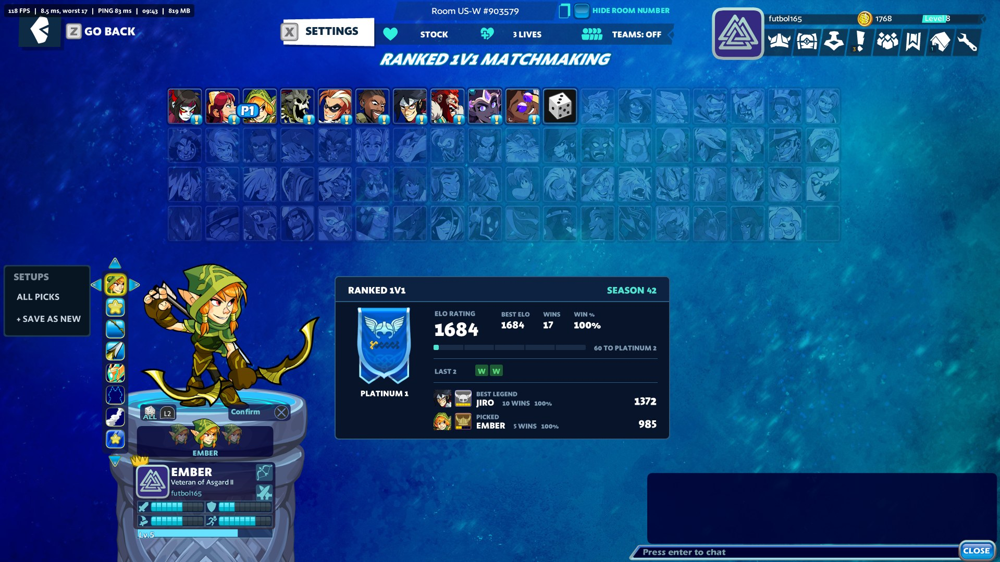<br>Ranked card and Legend Setups in character select</td></tr>
<tr><td width="50%">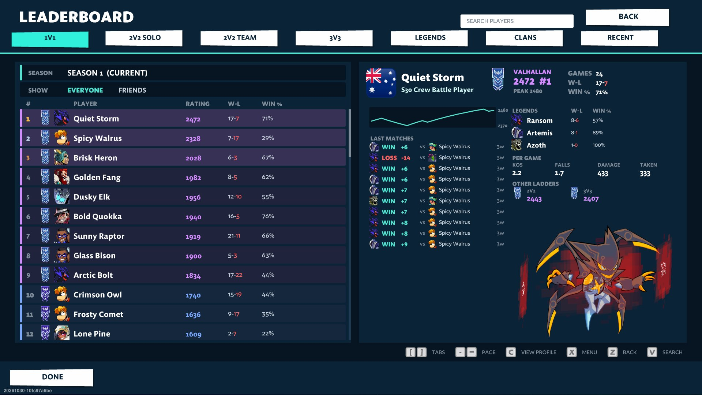<br>Leaderboard with a player's profile</td><td width="50%">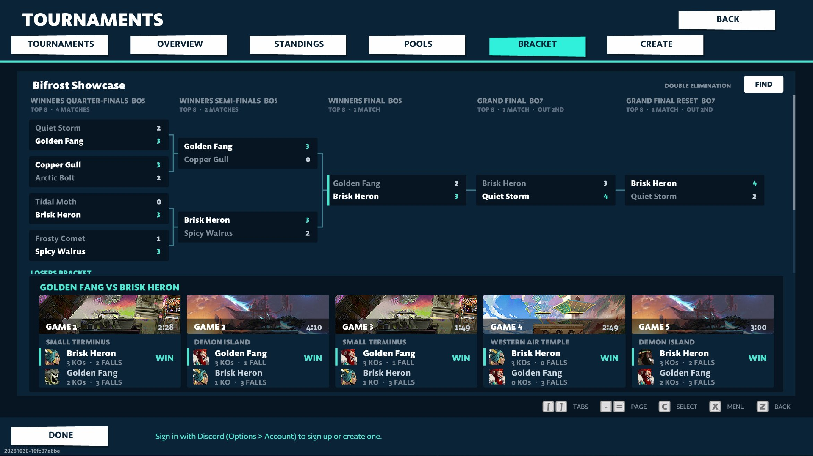<br>Tournament bracket with every game's result</td></tr>
<tr><td width="50%">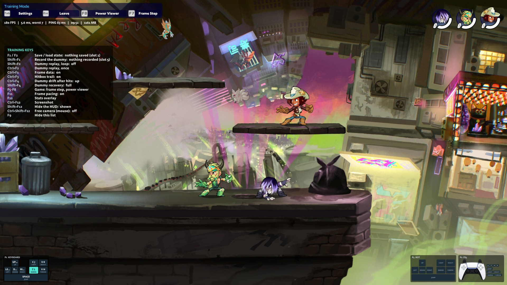<br>Training with the key list and input display</td><td width="50%">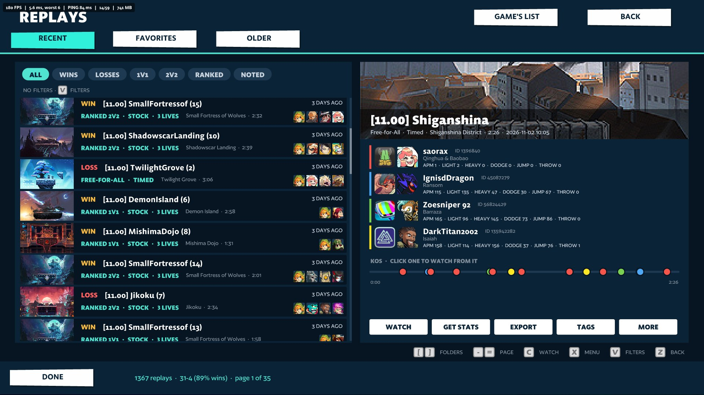<br>Replays with quick filters and a KO timeline</td></tr>
<tr><td width="50%">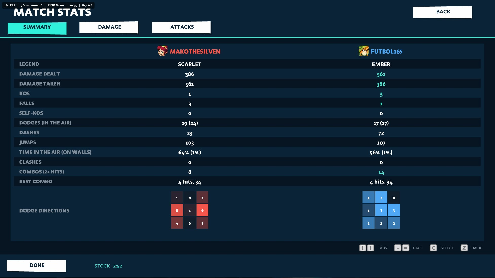<br>Match stats: summary</td><td width="50%">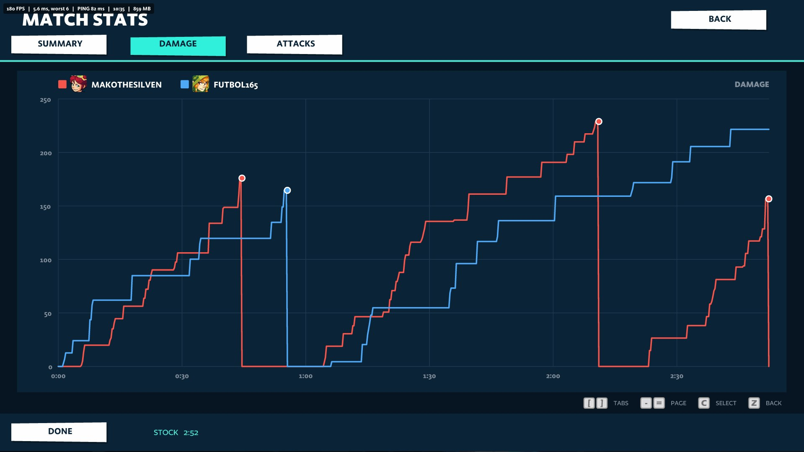<br>Match stats: damage over the match</td></tr>
<tr><td width="50%">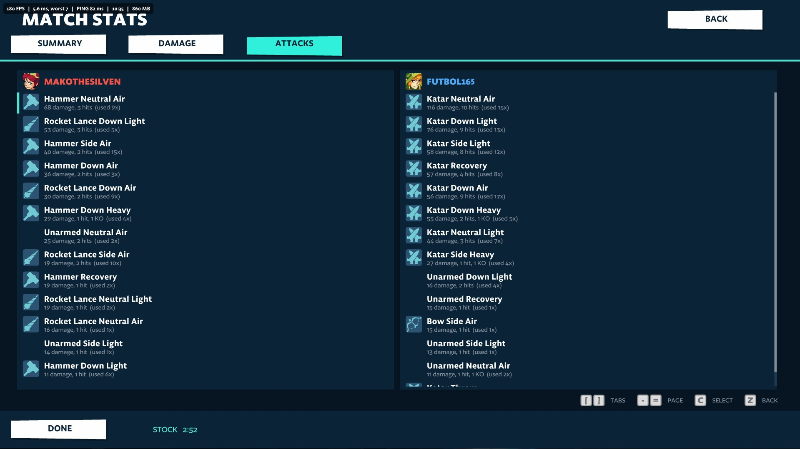<br>Match stats: attacks</td><td width="50%">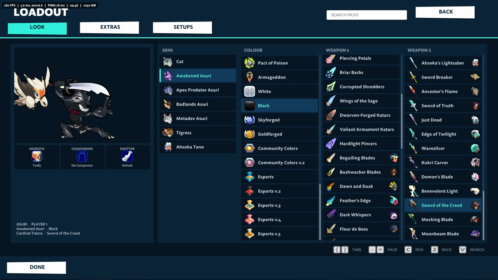<br>Loadout: skin, colour and weapons</td></tr>
<tr><td width="50%">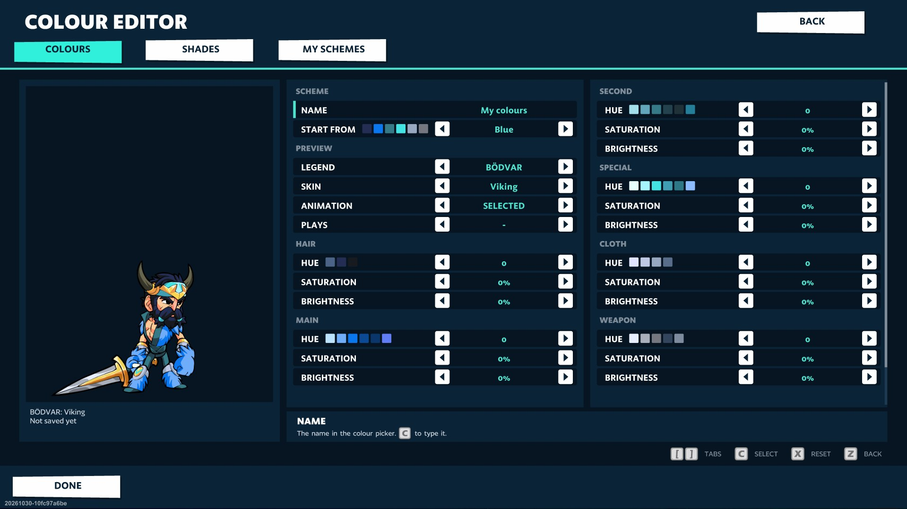<br>Colour editor</td><td width="50%">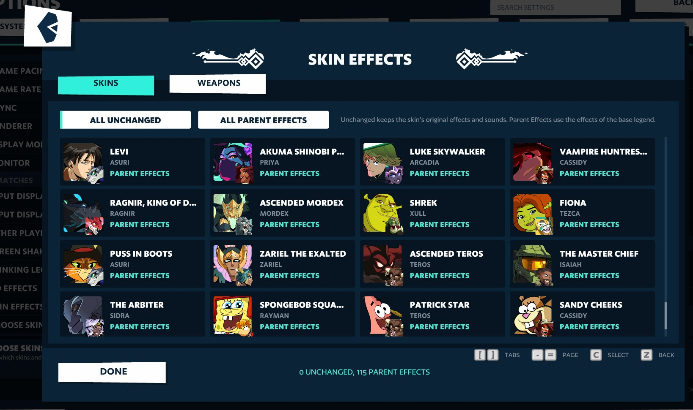<br>Skin effects</td></tr>
<tr><td width="50%">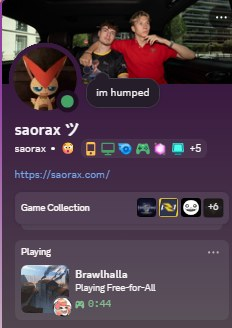<br>Discord Rich Presence</td></tr>
</table>

## Branches

| Branch | What's in it |
| --- | --- |
| `main` (this one) | Bifrost's layer: the AS3 it adds to the game, its mods and its tools |
| `engine` | the new engine Bifrost runs on (HashLink + Heaps), the converter and the player kit the app downloads |

Related: [bifrost-server](https://github.com/Saorax/bifrost-server) (the server Bifrost connects to) and
[bh-client](https://github.com/Saorax/bh-client) (the official-servers client).

## What's here

| Path | Contents |
| --- | --- |
| `src/platform/as3/bh/` | Bifrost's AS3: the platform (hooks into the game, networking, windows) and its mods |
| `src/mods/` | small changes to the game's own code (offline switch, separate saves, ID limits) |
| `client/symbols/` | maps between the game's obfuscated names and readable ones (names only, no code) |
| `tools/` | Python tools: exporting and building (`export_as3.py`, `build_as3_game.py`), the map editor, the native P2P relay (C#), the Discord bridge |
| `examples/mods/` | example content mods |

## Building

Players never build: the app does it on their PC from the `engine` branch. To work on Bifrost you need Python 3.11+,
Java and [FFDec](https://github.com/jindrapetrik/jpexs-decompiler) in `.tools/ffdec`, and your own Brawlhalla
install's files in `versions/<version>/` (both git-ignored). Then:

```bat
python tools/export_as3.py --version 11.00
python tools/build_as3_game.py --version 11.00
```

The `engine` branch turns the same layer into the game players run (see its README).

## Releases

Releases are built on your own PC, because they need your Brawlhalla install and the data the converter made from it,
which never leave it. Both branches have a GitHub Actions workflow (`.github/workflows/release.yml`) that runs on a self-hosted runner there:
every push that changes the source, or a manual run from the Actions tab, builds the release with
`tools/player_release.py --publish` in the engine folder and creates the GitHub release. Players' apps then offer the
update.

One-time setup, in this repo's Settings:

1. **Actions > Runners > New self-hosted runner** (Windows x64): follow its commands in a new folder (for example
   `C:\actions-runner\bifrost`), answer the labels question with `brawlhalla`, and let it run as a service. Python, Git,
   the GitHub CLI and the build toolchain must be on that service's PATH.
2. **Actions > General > Fork pull request workflows**: require approval for all outside collaborators. A public repo's
   pull requests can carry their own workflows, and this runner is your PC, so never approve one you haven't read.
3. Optional **Secrets and variables > Actions > Variables**: `BIFROST_ENGINE_DIR` if the engine branch isn't checked out
   at `C:\Coding\bifrost-engine`, and `BIFROST_SERVER` (`host:port`), the server releases play on (without it, `bifrost.saorax.com:7910`).

The workflow builds from your folders as they are, so push from the same folders you build in.

## License

MIT, see [LICENSE](LICENSE).
